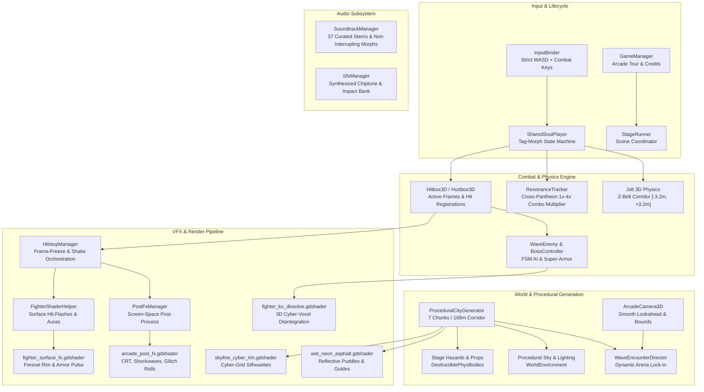
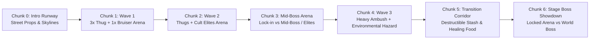

# Side Beat

[](https://godotengine.org)
[](https://github.com/godot-jolt/godot-jolt)
[](tests/run_tests.gd)
[](LICENSE)
[](LICENSE-AUDIO)
[](tracks/)

A fast-paced **2.5D Belt-Scroller Arcade Tag-Morph Fighter** built from the ground up in **Godot 4.7** using the **Forward+ Renderer** and **Jolt 3D Physics**.

Players fight through a procedurally generated 7-city Urban World Tour (New York, Los Angeles, Madrid, Moscow, London, Tokyo, and Rome) battling 12 mythic bosses. At any frame—mid-string, airborne, or in hitstop—players can execute zero-cooldown **Shared-Soul Morphs** across 4 pantheon gods, chaining weapon stances, elemental specials, and fighting-game juggles driven by custom real-time shaders and a curated 37-track original soundtrack.

---

## Technical Architecture



---

## Custom Shaders & Render Pipeline

Side Beat utilizes a modular suite of **9 custom GLSL/Godot shaders** operating across spatial geometry, particle meshes, and screen-space passes:

| Shader | Type | Key Capabilities |
| :--- | :--- | :--- |
| [`arcade_post_fx.gdshader`](shaders/arcade_post_fx.gdshader) | CanvasItem | 3 CRT presets, phosphor masks, barrel distortion, radial parry ripples, chromatic glitch rolls |
| [`fighter_surface_fx.gdshader`](shaders/fighter_surface_fx.gdshader) | Spatial (Next-Pass) | 2-frame additive hit-flash, pantheon Fresnel rims, boss Phase 2 enrage strobe |
| [`fighter_ko_dissolve.gdshader`](shaders/fighter_ko_dissolve.gdshader) | Spatial | 3D voxel/hash noise dissolve disintegrating defeated foes into synthwave embers |
| [`combat_hit_slash.gdshader`](shaders/combat_hit_slash.gdshader) | Spatial (Additive) | Anime/arcade slashing ribbons, saturated neon edges, radial impact starbursts |
| [`energy_shockwave.gdshader`](shaders/energy_shockwave.gdshader) | Spatial (Additive) | Concentric ground shockwaves and high-voltage scrolling plasma pillars |
| [`danger_telegraph.gdshader`](shaders/danger_telegraph.gdshader) | Spatial | Scrolling 45° hazard chevrons, pulsing neon perimeter, 0.0 $\rightarrow$ 1.0 countdown sweep |
| [`wet_neon_asphalt.gdshader`](shaders/wet_neon_asphalt.gdshader) | Spatial | Procedural world-space puddles, rain ripples, neon planar reflections, Z-corridor guides |
| [`skyline_cyber_rim.gdshader`](shaders/skyline_cyber_rim.gdshader) | Spatial | Cyber-grid skyscraper edges, pulsing rooftop beacons, distance atmospheric fog |
| [`synthwave_cityline.gdshader`](shaders/synthwave_cityline.gdshader) | CanvasItem | 3D perspective scrolling neon ground grid, procedural skyline with flickering windows |

### 1. Arcade Post-FX: Screen-Space Ripple & Chromatic Glitch

The post-processing pipeline ([`arcade_post_fx.gdshader`](shaders/arcade_post_fx.gdshader)) handles dynamic parry ripples, full-screen impact freezes, and digital glitch artifacts without interrupting 60 FPS gameplay.

```glsl
// Screen-Space Radial Shockwave Distortion (Parry & Super Impacts)
vec2 to_pixel = uv - ripple_center;
to_pixel.x *= aspect;
float dist = length(to_pixel);
float ring = smoothstep(ripple_width, 0.0, abs(dist - ripple_radius)) * (1.0 - ripple_progress);
vec2 distorted_uv = uv + normalize(uv - ripple_center) * ring * 0.045 * (1.0 - ripple_progress);

// RGB Channel Split Glitch (Shared-Soul Morphs & Boss Enrage)
float r_ch = texture(screen_texture, distorted_uv + vec2(glitch_offset, 0.0)).r;
float g_ch = texture(screen_texture, distorted_uv).g;
float b_ch = texture(screen_texture, distorted_uv - vec2(glitch_offset, 0.0)).b;
```

### 2. Fighter Surface FX: Pantheon Rim & Hitstop Emission

Attached as a `next_pass` material on all humanoid God rigs, enemies, and bosses ([`fighter_surface_fx.gdshader`](shaders/fighter_surface_fx.gdshader)), this shader provides immediate visual feedback for combat states:

```glsl
// Fresnel Rim Lighting colored by Active God / Boss Stance
float NdotV = max(dot(normalize(NORMAL), normalize(VIEW)), 0.0);
float fresnel = pow(1.0 - NdotV, rim_power) * rim_strength;

// Frame-Exact Combat Hit-Flash
vec3 out_color = mix(base_albedo, hit_flash_color.rgb, hit_flash_amount);
out_color += rim_color.rgb * fresnel;

// Super-Armor & Enrage Pulse Waves
float armor_pulse = sin(TIME * pulse_speed) * 0.5 + 0.5;
out_color += vec3(1.0, 0.1, 0.2) * (enrage_factor * armor_pulse * 1.5);
```

### 3. Cyber-Voxel Disintegration (Defeat FX)

Defeated enemies dissolve upward into glowing synthwave embers using 3D world-space voxel hashing ([`fighter_ko_dissolve.gdshader`](shaders/fighter_ko_dissolve.gdshader)):

```glsl
// Procedural 3D Voxel Hash Noise
vec3 grid_pos = floor(v_local_pos * voxel_scale);
float noise_val = hash31(grid_pos);

// Upward Burning Gradient with Embers
float threshold = dissolve_progress * 1.3 - (v_local_pos.y * 0.4);
if (noise_val < threshold) {
    discard;
}
```

---

## Procedural Level Generation & VFX Orchestration

### Procedural City Generation Pipeline

Stages are generated procedurally by [`ProceduralCityGenerator`](scripts/world/procedural_city_generator.gd) into a 168-meter runway divided into 7 distinct 24-meter chunks:



- **Deterministic Seeding**: Levels generate deterministically using `rng.seed = stage_num * 1337 + 42` (or custom seeds), ensuring reproducible speedrun layouts.
- **Sub-Biome Theming**: Chunks transition across 3 sub-biomes per city (e.g., Tokyo: *Akihabara Neon $\rightarrow$ Shinjuku Alleys $\rightarrow$ Shibuya Rooftops*), swapping road shaders, neon palettes, and prop densities.
- **Corridor Z-Boundary**: Gameplay is locked to a shallow belt-scroller strip ($Z \in [-3.2\text{m}, +3.2\text{m}]$), preventing off-plane drift while preserving full 3D vertical launch and bounce physics.
- **Hazard Integration**: Automatically injects dynamic stage hazards into chunk corridors:
  - *Moscow*: Low-friction ice slicks (`ice_slick`).
  - *London*: Intermittent blinding steam bursts (`steam_vent`).
  - *Tokyo*: High-voltage rhythmic electric arcs (`electric_arc`).
  - *Rome*: Burning lava braziers with knockback burns (`lava_brazier`).

### Frame-Exact Hitstop & Combat Impact Hierarchy

Combat weight is governed by [`HitstopManager`](scripts/autoload/hitstop_manager.gd), which manipulates frame-freezes and screen trauma dynamically without altering soundtrack tempo:

```
┌─────────────────────────┬──────────────────────┬────────────────────────────────────────────────────────┐
│ Impact Event            │ Freeze Duration      │ Visual FX Triggered                                    │
├─────────────────────────┼──────────────────────┼────────────────────────────────────────────────────────┤
│ Destructible Prop Hit   │ 0 Frames (Snappy)    │ Wood/Metal particle burst + PickupItem spawn           │
│ Enemy Lethal KO         │ 2 Frames (~0.033s)   │ Surface flash + Voxel dissolve + Physics ragdoll pop   │
│ Light / Normal Attack   │ 3-5 Frames           │ Directional slash particle streak + Spark burst        │
│ Heavy Launcher / Smash  │ 6-7 Frames           │ Ground shockwave ring + Camera shake (Trauma 0.35)     │
│ Perfect Aegis Parry     │ 8 Frames             │ Screen shockwave ripple + Radial high-contrast flash   │
│ Pantheon Super Special  │ 12-14 Frames         │ Screen glitch roll + Lightning pillar + Heavy trauma   │
└─────────────────────────┴──────────────────────┴────────────────────────────────────────────────────────┘
```

---

## Core Gameplay Systems

### Shared-Soul Morph Mechanics
Players switch instantly between four mythic gods sharing a single health pool ($1,000\text{ HP}$) and unified Pantheon Meter:

1. **Endor (Norse / Asgard)** — *Heavy Armor-Breaker & Thunder Brawler*: Uninterruptible hyper-armor hammer swings and ground-shattering AoE lightning.
2. **Ir (Greek / Olympus)** — *High-Speed Rushdown & Aegis Parry*: Frame-tight dashes, twin-blade cross-slashes, and projectile counter-parries.
3. **Osiris (Egyptian / Duat)** — *Mid-Range Spacing & Underworld Curses*: Spectral khopesh sweeps, life-leech souls, and space-controlling sarcophagus barriers.
4. **Horus (Egyptian / Solar)** — *Aerial Dominance & Solar Juggles*: Wing launch uppercuts, aerial dive-kicks, and radiant solar spear barrages.

> [!NOTE]
> **State Preservation On Morph**: Swapping gods instantly preserves linear velocity, left/right facing stance, airborne juggle state, and active combo counters with 2 frames of hitstun immunity. Active music tracks continue playing without interruption.

### Cross-Pantheon Resonance Multiplier
Chaining attacks across different gods within a single juggle string dynamically scales score and meter gains via [`ResonanceTracker`](scripts/combat/resonance_tracker.gd):

$$\text{Resonance Multiplier} = \begin{cases} 
1.0\times & \text{1 God (Mono-Pantheon)} \\
1.75\times & \text{2 Gods} \\
2.75\times & \text{3 Gods} \\
4.0\times & \text{4 Gods (GODLIKE Resonance)} 
\end{cases}$$

---

## Controls

All controls are mapped directly to low-latency arcade keyboard bindings:

| Action | Primary Key | Alternate | Description |
| :--- | :---: | :---: | :--- |
| **Move Up / Walk Back (Z-)** | <kbd>W</kbd> | — | Step into the background corridor |
| **Move Down / Walk Forward (Z+)** | <kbd>S</kbd> | — | Step toward the foreground corridor |
| **Move Left (-X)** | <kbd>A</kbd> | — | Run / face left |
| **Move Right (+X)** | <kbd>D</kbd> | — | Run / face right |
| **Jump** | <kbd>Space</kbd> | — | Vertical leap / aerial juggle starter |
| **Heavy Attack / Launcher** | <kbd>K</kbd> | — | Armor-breaking strike / vertical pop |
| **Pantheon Special** | <kbd>L</kbd> | — | Stance special (consumes meter) |
| **Pantheon Super** | <kbd>O</kbd> | — | Full-screen pantheon ultimate |
| **Block / Perfect Parry** | <kbd>U</kbd> | — | Guard incoming strikes / frame-tight parry |
| **Morph Endor** | <kbd>1</kbd> | — | Instant switch to Norse Thunder Brawler |
| **Morph Ir** | <kbd>2</kbd> | — | Instant switch to Greek Rushdown Striker |
| **Morph Osiris** | <kbd>3</kbd> | — | Instant switch to Duat Underworld Scythe |
| **Morph Horus** | <kbd>4</kbd> | — | Instant switch to Solar Aerial Striker |

---

## Developer Quickstart

### Prerequisites
- **Godot Engine 4.7+** (with Forward+ renderer support)
- Git LFS (for audio tracks and rigged GLB assets)

### Launching the Game
```bash
# Clone the repository
git clone https://github.com/leonid-medovyy/side-beat.git
cd side-beat

# Launch game via Godot executable
godot --path . scenes/main/boot.tscn
```

### Running Headless Automated Tests
The repository includes an automated headless verification suite validating all 37 audio stems, rigged GLB character models, shader compilations, procedural generation algorithms, and combat physics:

```bash
godot --headless --path . tests/test_runner.tscn
```

Expected output:
```text
=== SIDE BEAT AUTOMATED VERIFICATION SUITE ===
[PASS] SoundtrackManager autoload is active
[PASS] Soundtrack catalog maps all 37 tracks (got 37)
[PASS] All 37 MP3 tracks load cleanly as AudioStreams
[PASS] God 'endor' GLB has Skeleton3D and AnimationPlayer
...
[PASS] Shader loads and compiles cleanly: res://shaders/arcade_post_fx.gdshader
[PASS] Shader loads and compiles cleanly: res://shaders/fighter_surface_fx.gdshader
[PASS] Shader loads and compiles cleanly: res://shaders/fighter_ko_dissolve.gdshader
[PASS] ProceduralCityGenerator road uses wet_neon_asphalt ShaderMaterial
[PASS] Prop destruction applies 0 hitstop frames to HitstopManager (snappy flow)
[PASS] Enemy lethal KO applies exactly 2 hitstop frames
==============================================
Assertions: 213 | Failures: 0
```

---

## Licensing & Attribution

This repository is distributed under a **Dual-License** model:

- **Game Engine & Source Code**: Released under the permissive **[MIT License](LICENSE)**. You are free to inspect, modify, fork, and adapt the Godot systems, GDScript files, scenes, tools, and custom shaders.
- **Original Music & Soundtracks**: All 37 original music tracks located in the [`tracks/`](tracks/) directory (`res://tracks/`) are **Proprietary & All Rights Reserved** by **Leonid Medovyy**. These tracks are included solely for local gameplay evaluation and may not be extracted, sampled, re-distributed, or used in other projects without prior written permission. See **[LICENSE-AUDIO](LICENSE-AUDIO)** for full terms.

Copyright © 2026 Leonid Medovyy.
